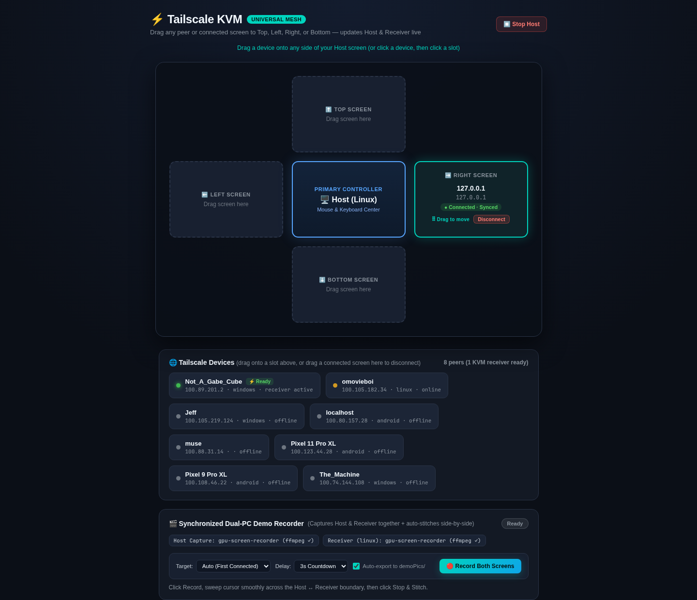
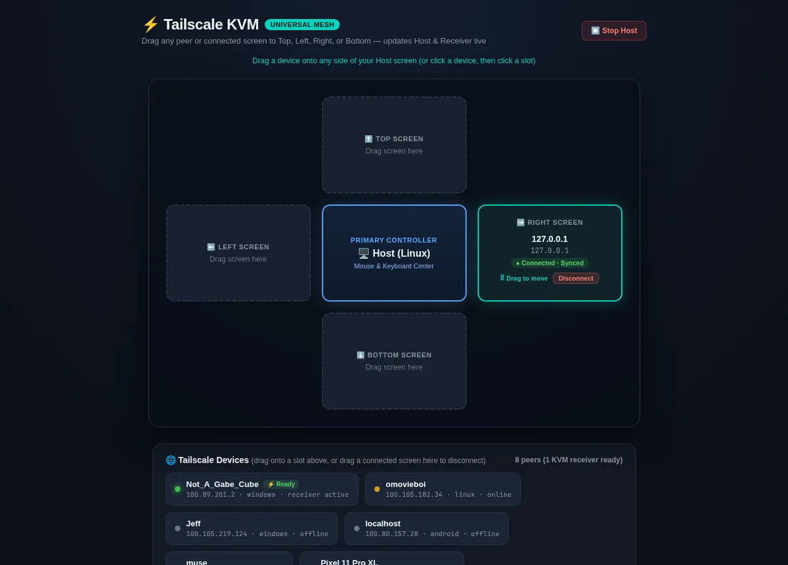
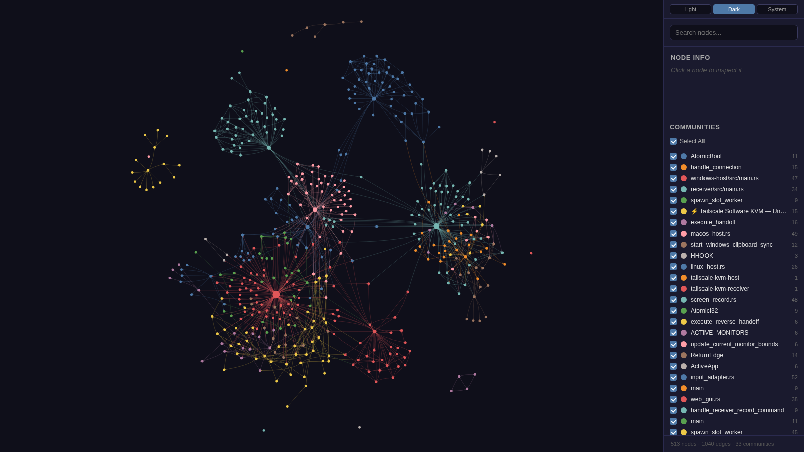

# ⚡ Tailscale Software KVM — Universal Multi-Directional Mesh (Pure Rust)

A low-latency, zero-overhead software KVM switch built in **100% pure Rust** (`host`, `receiver`, and shared capture modules) that turns **Windows, Linux (Wayland/Hyprland & X11), and macOS** machines on a **Tailscale** mesh VPN into a single seamless multi-monitor workspace—complete with drag-and-drop **2D topology routing**, kernel-level **`/dev/uinput`** injection, clipboard/file handoff, and a **synchronized dual-computer demo recorder**.

<div align="center">


</div>

---

## ✨ Showcase Preview

<div align="center">



*Interactive 2D Topology Dashboard (`http://localhost:9877`) featuring live Tailscale peer probing, drag-and-drop 4-way slot routing, and the synchronized Dual-PC Demo Recorder.*

<br />



*Live interaction workflow: assigning & repositioning Tailscale receivers across Top, Left, Right, and Bottom slots with instant reciprocal return-edge synchronization and dual-PC recording controls.*

</div>

---

## 🌟 Key Features

- **Universal 4-Way Multi-Directional Mesh:** Engineered a **pool of 4 independent TCP slot workers** (`Right`, `Left`, `Up`, `Down`) over **Tailscale (`100.x.y.z:9876`)** with monotonic session IDs and reciprocal return-edge negotiation (`E <edge>`), letting control flow cleanly in any physical monitor arrangement.
- **Wayland & Hyprland Kernel Input Injection:** Built a pure-Rust virtual HID pipeline backed by **`/dev/uinput`** and **`evdev`** on Linux (plus **`SendInput`** on Windows and **`CGEvent`** on macOS), bypassing compositor synthetic-input blocks with **sub-millisecond cursor & scancode forwarding**.
- **Zero-Ghost-Click Event Suppression:** Implemented low-level **`WH_MOUSE_LL`** and **`WH_KEYBOARD_LL`** hooks on **Windows**, **`EVIOCGRAB`** on **Linux**, and **`CGEventTap`** on **macOS** to swallow local host events while controlling a remote node—eliminating duplicate clicks and leaked keystrokes.
- **Zero-Config Tailscale Discovery & Low-Idle Resource Usage:** Queries `tailscale status --json` with concurrent `:9876` port probes (`220ms` timeout), throttles background polling (`3s` while UI is active, `20s` idle), and parks sleeping TCP/clipboard loops with **~4.6 MB resident RAM** and negligible CPU load.
- **Cross-OS Clipboard, Image & Browser/Explorer Handoff:** Synchronizes Unicode text (`T`), raw bitmap/PNG images (`I`), streaming binary files (`B` in fixed 64 KB chunks), active browser URLs (`U` via **`Win + Arrow`**), and terminal directories (`D` via **`Win + Alt + T`**) across machines.
- **Synchronized Dual-Computer Screen Recorder & Auto-Stitcher:** Orchestrates lockstep capture across Host and Receiver (`REC_START` / `REC_STOP` / `REC_STITCH`), transfers clips over the mesh without desktop clutter (`__kvm_rec__/`), and composites **spatial side-by-side `.webp`, `.gif`, and `.mp4` demos** automatically.

---

## 🏗 Architecture & Tech Stack

```text
                        +-------------------------------------+
                        |       TOP RECEIVER (Slot 2)         |
                        |   Linux / Windows / macOS Daemon    |
                        |      TCP :9876  (Return: Down)      |
                        +-------------------------------------+
                                           ^
                                           |
+-------------------------------+          |          +-------------------------------+
|    LEFT RECEIVER (Slot 1)     | <--------+--------> |    RIGHT RECEIVER (Slot 0)    |
|     Encrypted Tailscale       |   TCP Mesh Tunnel   |    Linux / Hyprland Node      |
|      TCP :9876 (Right)        |   100.x.y.z:9876    |     /dev/uinput + wl-copy     |
+-------------------------------+                     +-------------------------------+
                                           ^
                                           |  Control + Clipboard + REC_* + 64KB Streams
                                           v
                        +-------------------------------------+
                        |      HOST CONTROLLER (Center)       |
                        |  WH_MOUSE_LL / evdev / CGEventTap   |
                        |   Web Dashboard @ localhost:9877    |
                        |  + Shared Dual-PC Screen Recorder   |
                        +-------------------------------------+
```

### Wire Protocol Highlights (Port `9876`)
| Packet | Direction | Purpose |
| --- | --- | --- |
| `H control` / `E <edge>` | Host → Receiver | Establishes active control channel and synchronizes reciprocal return edge |
| `M dx dy` / `C` / `S` / `K` | Host → Receiver | Relative mouse motion, clicks, high-precision wheel deltas, and evdev/VK keycodes |
| `X <pos> [span]` / `Y <pos> [span]` | Host ↔ Receiver | Proportional cursor alignment across differing monitor resolutions |
| `T` / `I <len>` / `B <len> <path>` | Bidirectional | Escaped UTF-8 text clipboard, PNG image clipboard, and 64 KB chunked file streaming |
| `U <url>` / `D <cwd>` | Bidirectional | Instant Chrome/Firefox tab teleport and terminal CWD handoff |
| `PING <ts>` / `PONG <ts>` | Bidirectional | Real-time round-trip latency (RTT) and network jitter telemetry |
| `SYS_LOCK` | Host → Receiver | Synchronized multi-workstation screen lock (`hyprlock`/`swaylock`/`LockWorkStation`) |
| `REC_PING` / `REC_START` / `REC_STOP` / `REC_STITCH` | Bidirectional | Synchronized dual-PC recording handshake, transfer, and remote FFmpeg stitching |

### Repository Layout
```text
tailscale-kvm/
├── host/
│   ├── src/
│   │   ├── main.rs            # Windows Host hooks, 4-slot mesh router, recorder coordinator
│   │   ├── linux_host.rs      # Native Linux Wayland/X11 edge detection & EVIOCGRAB capture
│   │   ├── macos_host.rs      # macOS CGEventTap & Display bounds integration
│   │   ├── web_gui.rs         # Embedded HTTP REST API & static UI server (:9877)
│   │   └── vk_map.rs          # Full Win32 Virtual-Key ↔ Linux evdev scancode translation
│   └── gui_static/index.html  # Single-file 2D Drag-and-Drop Dashboard + Dual-PC Recorder UI
├── receiver/
│   └── src/
│       ├── main.rs            # Tokio async TCP daemon, boundary return detection & clipboard sync
│       └── input_adapter.rs   # Unified /dev/uinput, Win32 SendInput & macOS CGEvent injector
├── shared/
│   └── screen_record.rs       # Multi-OS capture backends, Win32 GDI+ MJPEG writer & FFmpeg stitcher
├── scripts/
│   ├── stitch-demo.sh         # Linux/macOS live API recorder & offline FFmpeg dual stitcher
│   └── stitch-demo.ps1        # Windows PowerShell live API recorder & offline stitcher
├── demoPics/                  # Portfolio & GitHub visual showcase assets
└── graphify-out/              # Automated AST code-graph visualization & call-flow reports
```

- **Host Controller:** **Rust 2021**, **Win32 API (`windows-sys`)**, **Linux `evdev`**, **macOS `core-graphics`**
- **Receiver Daemon:** **Tokio** async TCP runtime, **Linux `/dev/uinput`**, **`hyprctl`** monitor bounds, **`wl-clipboard`**
- **Web Dashboard:** Dependency-free **Rust `TcpListener`** HTTP server, **HTML5 / CSS3 / Vanilla JS** pointer drag-and-drop canvas
- **Dual-PC Media Pipeline:** **`gpu-screen-recorder`**, **`wf-recorder`**, **`FFmpeg`** (`libx264`, `libwebp_anim`, `palettegen`), and zero-dependency **C# / Win32 GDI+ MJPEG AVI** fallback (`CREATE_NO_WINDOW`)

---

## 🎬 Dual-Computer Demo Recording & Portfolio Sync

Click **🔴 Record Both Screens** in `http://localhost:9877` (or run `./scripts/stitch-demo.sh`) to capture both connected PCs simultaneously:

| OS | Primary Capture Backend | Zero-Dependency Fallback | Stitching Capability |
| --- | --- | --- | --- |
| **Linux (Wayland / X11)** | `gpu-screen-recorder` (with hardware cursor) | `wf-recorder` → `ffmpeg -f x11grab` | Local `ffmpeg` (`hstack`/`vstack`) |
| **Windows** | `ffmpeg.exe -f gdigrab -draw_mouse 1` | **Win32 GDI+ MJPEG `.avi`** (PowerShell, no console popup) | Local `ffmpeg` **or auto-delegated to Linux Receiver** |
| **macOS** | `ffmpeg -f avfoundation -capture_cursor 1` | `/usr/sbin/screencapture -x -v` | Local `ffmpeg` or remote delegation |

- Recordings are stored per session in `recordings/demo_<timestamp>/` and automatically combined according to your active layout (`left`/`right` side-by-side or `up`/`down` stacked) into **`dual_demo.webp`**, **`dual_demo.gif`**, and **`dual_demo.mp4`**, with one-click export to **`demoPics/02-dual-screen-demo.webp`**.
- You can also stitch any two manually recorded clips offline:
  ```bash
  ./scripts/stitch-demo.sh --host windows.mp4 --recv linux.mp4 --layout right \
    --host-label "WINDOWS HOST" --recv-label "OMARCHY RECEIVER"
  ```

---

## 🚀 Setup & Installation

### 1. Build the Workspace
```bash
git clone https://github.com/ryguy0601/tailscale-kvm.git
cd tailscale-kvm

# Linux / macOS
./build.sh
```
```powershell
# Windows (PowerShell)
.\build.ps1
```

### 2. Enable Boot-Time Linux `/dev/uinput` Access & Receiver Auto-Start
To run the Linux receiver cleanly on every boot without manual commands or resource drain:
```bash
# Persist uinput kernel module and unprivileged input-group permissions
echo uinput | sudo tee /etc/modules-load.d/uinput.conf
echo 'KERNEL=="uinput", MODE="0660", GROUP="input", OPTIONS+="static_node=uinput"' | sudo tee /etc/udev/rules.d/99-uinput.rules
sudo usermod -aG input "$USER"
sudo modprobe uinput && sudo udevadm control --reload-rules && sudo udevadm trigger

# Enable lightweight systemd user daemon (~5 MB RAM idle, sleeps silently when host is offline)
systemctl --user enable --now kvm-rust-receiver.service
```

### 3. Run Everywhere (Unified Node)
- **One command to run anywhere:** `.\run-kvm.ps1` (Windows) or `./run-kvm.sh` (Linux/macOS).
  - Automatically runs the Receiver daemon in the background (so the computer can receive mouse/keyboard/files) AND launches the Host controller with the Web GUI (so it can also control other screens).
- **Dedicated modes (optional):**
  - **Receiver only:** `.\run-kvm.ps1 receiver` or `./run-kvm.sh receiver` (or `.\run-receiver.ps1` / `./run-receiver.sh`)
  - **Host only:** `.\run-kvm.ps1 host` or `./run-kvm.sh host` (or `.\run-host.ps1` / `./run-host.sh`)

---

## 🎮 Controls & Shortcuts

| Action | Trigger |
| --- | --- |
| **Enter Receiver Screen** | Move cursor past the assigned screen edge (**Right**, **Left**, **Top**, or **Bottom**) with pressure barrier suppression |
| **Return to Host** | Exit the matching opposite screen edge on the Receiver (or press **`F12`** / **`Pause`** / **`Scroll Lock`**) |
| **Quick Switch to Slot** | Press **`Ctrl + Alt + 1 / 2 / 3 / 4`** or **`Ctrl + Alt + Arrow`** to warp directly to any receiver |
| **Fling Active Window / Selected Files** | Press **`Win + Right / Left / Up / Down`** toward any connected Receiver |
| **Teleport Terminal at CWD** | Press **`Win + Alt + T`** to open a terminal on the connected peer |
| **Synchronized Screen Lock** | Click **🔒 Lock All** in the Dashboard or dispatch `SYS_LOCK` |

---

## 🕸 Graphify Knowledge Graph

This repository includes pre-computed **Graphify** structural code graphs (`graphify-out/`) for architecture exploration:



```bash
# Refresh AST & architecture graph after code changes
graphify update .

# Export interactive Mermaid call-flow documentation
graphify export callflow-html
```

---

## 📄 License

Distributed under the [MIT License](LICENSE).
