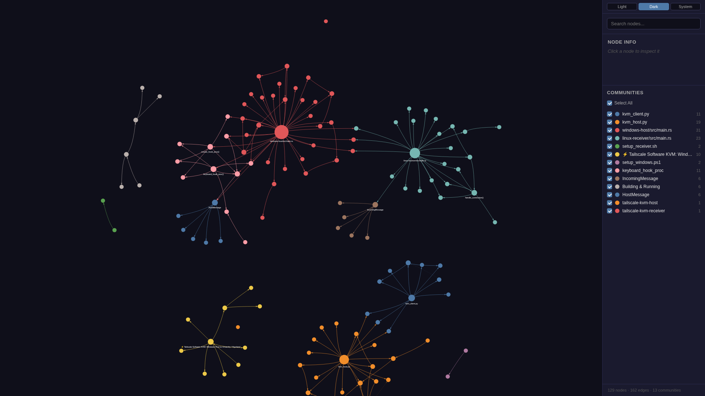
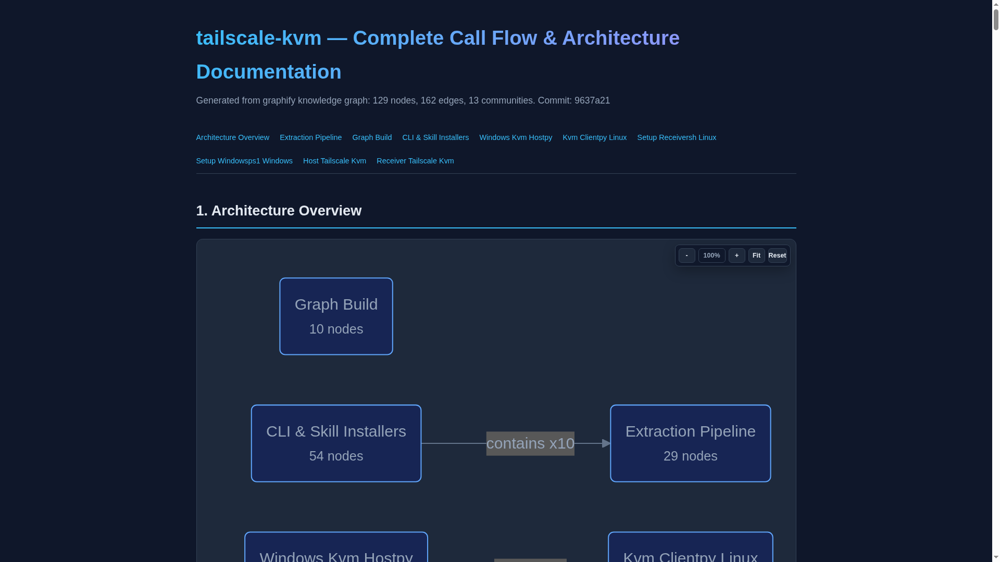

# ⚡ Tailscale Software KVM: Windows Host to Omarchy / Hyprland

A lightweight, zero-latency cross-platform software KVM switch bridging Windows workstations to Omarchy Linux (Hyprland / Wayland) over an encrypted Tailscale mesh network with kernel-level `/dev/uinput` synthetic event injection. **Available in both high-performance Rust and portable Python implementations.**

<div align="center">


</div>

---

## 🌟 Key Features

- **Blazing Fast Native Rust & Python Engines:** Includes a full native **Rust workspace** (`tokio` async networking, `windows-sys` Win32 hooks, `evdev::uinput` injection) alongside our zero-dependency Python implementation.
- **Kernel-Level Input Injection (`/dev/uinput`):** Uses **`evdev`** / **`python-evdev`** to emit hardware-level mouse movements, relative scrolls, clicks, and scancodes directly into the Linux input subsystem, completely bypassing Wayland security boundaries and compositor synthetic event blocking.
- **Low-Latency Encrypted Mesh Transport:** Communicates via dedicated TCP streams with **`TCP_NODELAY`** enabled over a private **Tailscale** peer-to-peer mesh VPN, guaranteeing sub-millisecond edge input transmission without public exposure or port forwarding.
- **Bi-Directional Seamless Monitor Edge Transitions:** 
  - Move cursor past the **right edge of Windows** $\rightarrow$ Seamlessly enters Omarchy.
  - Move cursor past the **left edge of Omarchy** $\rightarrow$ Automatically returns to Windows without pressing any hotkeys!
- **Complete Event Suppression (No Ghost Clicks):** Uses low-level Win32 hooks (`WH_MOUSE_LL` and `WH_KEYBOARD_LL`) to swallow inputs on Windows while in remote mode, eliminating duplicate clicks and phantom keystrokes.
- **Comprehensive Keycode & Hotkey Support:** Full translation table for Hyprland hotkeys (`Super / Windows Key`, `Alt`, `Shift`, `Backspace`, function keys, and symbols).
- **Clipboard Synchronization:** Background monitor keeps clipboards in sync between Windows and Omarchy using `arboard` (Rust) and `wl-clipboard` / Win32 APIs (Python).
- **Graphify Code Graph Integration:** Features automated AST structural code analysis, call flow mapping, and visual knowledge graphs generated via **Graphify**.

---

## 🏗 Architecture & Tech Stack

```text
+-----------------------------------------------------------------------------------+
|                            WINDOWS HOST CONTROLLER                                |
|  Raw Win32 Hooks (WH_MOUSE_LL / WH_KEYBOARD_LL) via windows-sys & pynput          |
|  Event Suppression Engine  +  Relative Center-Warp Delta Tracker                  |
|  Bidirectional Clipboard Engine (arboard / pyperclip)                             |
+------------------------------------------+----------------------------------------+
                                           |
                                  TCP Stream (TCP_NODELAY)
                                  Encrypted Tailscale Mesh
                                           |
                                           v
+-----------------------------------------------------------------------------------+
|                        OMARCHY / HYPRLAND CLIENT RECEIVER                         |
|  Async Tokio / AsyncIO Socket Server (Port 9876)                                  |
|                                          |                                        |
|             +----------------------------+----------------------------+           |
|             v                                                         v           |
|  Kernel /dev/uinput (evdev / python-evdev)                   Wayland wl-clipboard |
|  [Virtual Mouse & Keyboard Device]                           [Clipboard & Notify] |
|             |                                                         |           |
|             v                                                         v           |
|  Wayland Compositor (Hyprland Core)                          Omarchy Desktop UI   |
|  [Dynamic Left Edge Boundary Monitor (hyprctl)]              [Screen Sync]        |
+-----------------------------------------------------------------------------------+
```

---

## 📊 Visual Overview & Architecture Graph

Visual demonstration assets and AST dependency graphs generated for this repository:

<div align="center">

| Architecture Knowledge Graph (`graphify` - 129 Nodes) | Call Flow & Component Sequence |
| :---: | :---: |
|  |  |

</div>

---

## 🚀 Setup & Usage

### Option A: High-Performance Rust Implementation

#### 1. Linux Receiver (Omarchy)
```bash
cd rust/linux-receiver
cargo build --release
./target/release/tailscale-kvm-receiver
```

#### 2. Windows Host (`not-a-gabe-cube`)
```powershell
cd rust\windows-host
cargo build --release
.\target\release\tailscale-kvm-host.exe 100.99.142.70
```

---

### Option B: Python Implementation (With Miniconda Support)

#### 1. Linux Receiver (Omarchy)
```bash
cd linux
./setup_receiver.sh
systemctl --user enable --now kvm-client.service
```

#### 2. Windows Host (`not-a-gabe-cube`)
```powershell
cd windows
.\setup_windows.bat
```

---

## 🎮 How to Control

- **Switch to Omarchy:** Move your mouse cursor against the **right edge of your Windows display**.
- **Switch back to Windows:** Move your mouse cursor against the **left edge of your Omarchy display**.
- **Emergency Release Hotkeys:** Press **`F12`**, **`Pause / Break`**, or **`Scroll Lock`** anytime to instantly release the cursor.

---

## 🕸 Graphify Knowledge Graph

This repository is indexed with **Graphify** for code comprehension and architecture analysis:

```bash
# Update AST analysis and graph reports
graphify update .

# Generate interactive Mermaid call flow HTML
graphify export callflow-html

# Open interactive visualization
xdg-open graphify-out/graph.html
```

---

## 📄 License

Distributed under the [MIT License](LICENSE).
